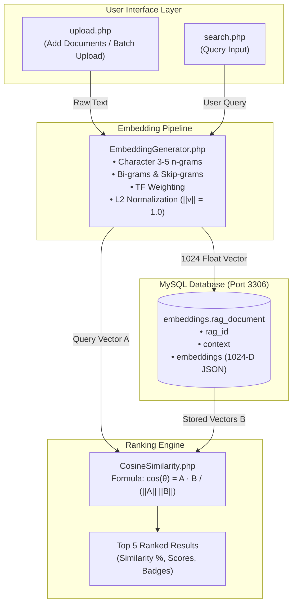

## 1024-Dimension RAG Semantic Search Engine (Native PHP)

[](https://www.php.net/)
[](https://www.mysql.com/)
[](https://github.com)
[](https://github.com)

A high-performance, native PHP vector embedding and Retrieval-Augmented Generation (RAG) semantic search application. It converts textual documents into normalized **1,024-dimensional float vectors** and calculates real-time **Cosine Similarity** rankings directly without external paid embedding APIs or Python dependencies.

---

## Table of Contents

- [Overview](#-overview)
- [Key Features](#-key-features)
- [System Architecture](#-system-architecture)
- [Database Configuration & Schema](#-database-configuration--schema)
- [Mathematical Foundation](#-mathematical-foundation)
- [Directory Structure](#-directory-structure)
- [Installation & Setup](#-installation--setup)
- [Usage Guide](#-usage-guide)
  - [1. Upload & Add Documents](#1-upload--add-documents)
  - [2. Semantic Search & Top-5 Results](#2-semantic-search--top-5-results)
- [Design Tokens & Aesthetics](#-design-tokens--aesthetics)
- [License & Copyright](#-license--copyright)

---

## Overview

Modern AI and RAG architectures depend on converting text into dense mathematical vectors to understand semantics and context. 

This project provides:
1. **Native PHP 1024-D Vector Engine**: Subword character $n$-gram extraction, skip-grams, TF weighting, and SimHash multi-hash projection with $L_2$-norm normalization.
2. **Knowledge Base Ingestion**: An upload portal supporting single record entry and 1-click batch ingestion of a sample knowledge dictionary.
3. **Cosine Similarity Search Engine**: Matches any natural language query against indexed documents using `CosineSimilarity.php` and ranks the **Top 5** results.

---

## Key Features

- **100% Native PHP**: Zero composer or external API key dependencies. Operates entirely inside Laragon / Apache.
- **Fixed 1024 Vector Dimensions**: Tailored for high-capacity semantic discrimination.
- **Auto Database Provisioning**: Automatic database and table creation upon first connection.
- **Curated Sample Dictionary**: Pre-configured knowledge base covering AI, Machine Learning, NLP, Vector Embeddings, RAG, MySQL, PHP, and Cloud Architecture.
- **Branded & Responsive UI**: Built with custom theme palettes, interactive percentage bars, rank badges (#1 to #5), and execution timing metrics.

---

## System Architecture



---

## Database Configuration & Schema

### Configuration (`Database.php`)
```php
"Host"     => "localhost",
"Port"     => "3306",
"Username" => "root",
"Password" => "",
"DBName"   => "embeddings"
```

### Table Structure (`rag_document`)
The system executes auto-migration on boot:

```sql
CREATE TABLE IF NOT EXISTS `rag_document` (
    `rag_id` INT AUTO_INCREMENT PRIMARY KEY,
    `context` TEXT NOT NULL,
    `embeddings` LONGTEXT NOT NULL,
    `created_at` TIMESTAMP DEFAULT CURRENT_TIMESTAMP
) ENGINE=InnoDB DEFAULT CHARSET=utf8mb4 COLLATE=utf8mb4_unicode_ci;
```

- **`rag_id`**: Auto-incrementing primary key.
- **`context`**: Document text or knowledge excerpt.
- **`embeddings`**: JSON array string containing exactly 1,024 floating-point coordinates `[0.0213, -0.0541, ...]`.
- **`created_at`**: Automatic timestamp.

---

## Mathematical Foundation

### 1. Vector Projection & Feature Hashing
Each token and subword feature $f$ is projected into the 1024-dimensional space via multi-hash signed projection:

$$V[h_1(f) \pmod{1024}] \mathrel{+}= s_1 \cdot w(f)$$

Where $w(f)$ is the logarithmic term frequency with stopword attenuation, and $s_1 \in \{-1, +1\}$ is derived from the hash sign bit.

### 2. $L_2$ Normalization (Unit Vector)
The vector is normalized to unit Euclidean length:

$$\hat{V} = \frac{V}{\sqrt{\sum_{i=1}^{1024} V_i^2}}$$

### 3. Cosine Similarity Formula (`CosineSimilarity.php`)
Calculates the angular proximity between query vector $\mathbf{A}$ and document vector $\mathbf{B}$:

$$\cos(\theta) = \frac{\mathbf{A} \cdot \mathbf{B}}{\|\mathbf{A}\| \|\mathbf{B}\|} = \frac{\sum_{i=1}^{1024} A_i B_i}{\sqrt{\sum_{i=1}^{1024} A_i^2} \sqrt{\sum_{i=1}^{1024} B_i^2}}$$

Normalized percentage conversion:

$$\text{Percentage} = \max\left(0, \min\left(1, \cos(\theta)\right)\right) \times 100\%$$

---

## Directory Structure

```text
embeddings/
├── CosineSimilarity.php     # Pure mathematical Cosine Similarity implementation
├── Database.php             # PDO connection handler and auto schema builder
├── EmbeddingGenerator.php   # 1024-dimension native vector generator
├── favicon.png              # Application logo and browser favicon
├── index.php                # Entry router (redirects to search.php)
├── sample_dictionary.php    # Predefined sample knowledge dataset (12 domain categories)
├── search.php               # Cosine similarity search interface with top-5 viewer
├── upload.php               # Upload / add records interface (single & batch)
└── README.md                # Project documentation
```

---

## Installation & Setup

### Prerequisites
- **PHP**: 8.1 or higher (with `pdo_mysql`, `mbstring` enabled).
- **MySQL**: Running on port `3306` (standard Laragon MySQL configuration).
- **Web Server**: Apache or Nginx (e.g., inside Laragon `www/` root).

### Quick Setup Steps
1. Clone or place this repository into your web server root:
   ```bash
   # Example in Laragon
   cd f:/Laragon/www/Semantic-Search/embeddings
   ```
2. Confirm your MySQL server is running on port **3306**.
3. Verify connection settings in `Database.php`:
   ```php
   "Host"     => "localhost",
   "Port"     => "3306",
   "Username" => "root",
   "Password" => "",
   "DBName"   => "embeddings"
   ```
4. Access the web interface in your browser:
   ```text
   http://localhost/Semantic-Search/embeddings/
   ```

---

## Usage Guide

### 1. Upload & Add Documents
Open `http://localhost/Semantic-Search/embeddings/upload.php`:
- **Single Document**: Enter any sentence or paragraph in the text area and click **"Generate 1024-D Vector & Save to Database"**.
- **Batch Upload**: Click **"Batch Upload All Dictionary Records"** to populate the database with the 12 curated entries from `sample_dictionary.php`.
- **Manage Records**: Review recent documents in `rag_document` or remove test records using the **Delete** button.

### 2. Semantic Search & Top-5 Results
Open `http://localhost/Semantic-Search/embeddings/search.php`:
1. Type a natural language question (e.g., *"How do vector embeddings work?"* or *"What is machine learning?"*).
2. Click **"Compute & Search"** or click one of the quick sample prompt tags.
3. The system converts your query to a 1024-D vector, calculates cosine similarity across all records, and displays:
   - **Rank #1 (Gold Badge)** to **Rank #5**.
   - **Similarity Percentage** with proportional visual progress bars.
   - **Raw Cosine Score** (e.g., `0.941235`).
   - Query embedding statistics and query pipeline execution time in milliseconds.

---

 
 
